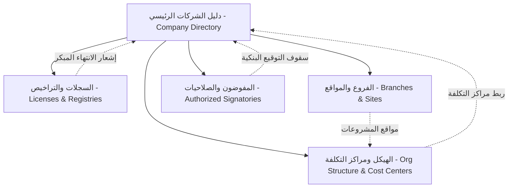

# منظومة ECO ERP المؤسسية المتكاملة (Enterprise Resource Planning)
> **الكتالوج الشامل للمنتج والمعمارية التقنية للمنظومة**  
> *نظام سحابي متطور متعدد الشركات والمؤسسات (Multi-Tenant / Multi-Company) مبني على بيئة Cloudflare Edge السحابية وقاعدة بيانات Cloudflare D1 الموزعة.*

---

## 1. نظرة عامة على المنظومة (System Overview)

منظومة **ECO ERP** هي منصة أعمال ذكية متكاملة لإدارة كبرى المجموعات القابضة وشركات المقاولات والكيانات التجارية. تجمع المنظومة بين الإدارة المالية الدقيقة، الحوكمة المؤسسية الشاملة للشركات والكيانات التابعة، إدارة العقود والتراخيص والمشاريع، ومراقبة الصلاحيات والمفوضين البنكيين في بيئة رقمية آمنة وموحدة.

### 1.1 الركائز التكنولوجية الأساسية (Core Tech Stack)
- **الواجهة الأمامية (Frontend):** React 18, TypeScript, Tailwind CSS, Framer Motion, Lucide Icons.
- **التصميم والهوية البصرية:** نمط ألوان مزدوج فاخر ("الزيتوني الملكي والزمردي الداكن" في النمط الليلي + "الرمادي الصخري عالي التباين والأبيض النقي" في النمط النهاري).
- **الخلفية البرمجية السحابية (Backend Edge):** Cloudflare Pages Functions (`functions/api/...`) ذات الاستجابة فائقة السرعة على شبكة الحافة العالمية.
- **قواعد البيانات (Database):** Cloudflare D1 Distributed SQL Database (SQLite-compatible engine with zero server management).
- **نظام التخزين المزدوج (Hybrid State):** استجابة فورية من الذاكرة (Optimistic In-Memory Cache) مع مزامنة خلفية حية ومستمرة مع قاعدة بيانات D1 السحابية.

---

## 2. موديول إدارة الشركات والحوكمة المؤسسية (`Company Management`)

يُعد هذا الموديول عصب المنظومة المؤسسي الذي تنبثق منه كافة القيود والعمليات. يتكون من خمسة أقسام فرعية مترابطة بصورة تكاملية:



### 2.1 الأقسام الفرعية وإمكانياتها (Sub-Modules)

#### 🏢 1. دليل الشركات (Company Directory)
- **الهدف:** توثيق الكيانات القانونية التابعة للمجموعة ومتابعة هياكل الملكية ورؤوس الأموال.
- **القدرات:**
  - إدارة الاسم التجاري والقانوني (عربي/إنجليزي)، الكود الفريد، والكيان القانوني (مساهمة، ذ.م.م، فرع شركة أجنبية).
  - ضبط رأس المال المرخص به والمصدر والمدفوع بدقة، مع حساب تلقائي للقيمة الاسمية وعدد الأسهم.
  - جدول تفصيلي لهيكل المساهمين والشركاء مع احتساب وتدقيق النسب المئوية آلياً لضمان اكتمال 100%.
  - سجل تعديلات تفصيلي (Audit Trail) يوثق كل تغيير يطرأ على بيانات الشركة ومساهميها.
- **جدول D1 المرتبط:** `companies`
- **نقطة النهاية:** `/api/companies`

#### 📑 2. السجلات والتراخيص (Licenses & Registries)
- **الهدف:** الحوكمة القانونية والرقابة الصارمة على الوثائق والمستندات الرسمية ومواعيد تجديدها.
- **القدرات:**
  - تتبع السجل التجاري، البطاقة الضريبية، التسجيل بضريبة القيمة المضافة، شهادة تصنيف المقاولين، وتأمينات المنشأة.
  - محرك التنبيه الذكي لمواعيد الانتهاء:
    - 🔴 **منتهي الصلاحية:** تحذير فوري عاجل.
    - 🟡 **ينتهي قريباً (أقل من 45 يوماً):** إشعار مبكر لاتخاذ إجراءات التجديد.
    - 🟢 **ساري المفعول:** مستند نشط وموثق.
  - أرشفة إلكترونية للوثائق مع إمكانية رفع وتحميل ومعاينة مستندات PDF والصور مباشرة.
- **جدول D1 المرتبط:** `company_licenses`
- **نقطة النهاية:** `/api/licenses`

#### 📍 3. الفروع والمواقع والمستودعات (Branches & Sites)
- **الهدف:** إدارة التوزيع الجغرافي للمقرات الإدارية، المخازن المركزية، والورش، ومواقع العمل الإنشائية.
- **القدرات:**
  - تصنيف نوع الموقع (مقر رئيسي، فرع إقليمي، مستودع تشوين، موقع مشروع قيد التنفيذ، ورشة).
  - تحديد المدينة، العنوان التفصيلي، ورابط الموقع الجغرافي التفاعلي على Google Maps.
  - ربط الموقع بالمدير المسؤول، كادر العمل الوظيفي، وتاريخ التسليم المتوقع.
  - ربط كل موقع بمركز التكلفة المخصص له لضمان الرقابة التشغيلية.
- **جدول D1 المرتبط:** `branches_sites`
- **نقطة النهاية:** `/api/branches`

#### 🌳 4. الهيكل التنظيمي ومراكز التكلفة (Organizational Structure & Cost Centers)
- **الهدف:** رسم خارطة التبعية الإدارية والوحدات التشغيلية للمجموعة دون تداخل مالي.
- **القدرات:**
  - شجرة هرمية تفاعلية تعرض الإدارات العامة، الأقسام، والوحدات الفرعية التابعة.
  - ربط الإدارة بالشركة الأم والمقر/الفرع الجغرافي التابع له.
  - ربط رمزي مع أكواد مراكز التكلفة (`Cost Center Code`) لسهولة التنسيق مع المحاسبة.
  - حماية هرمية ذكية تمنع حذف أي إدارة رئيسية ما دامت تحتوي على أقسام أو وحدات تابعة لها.
- **جدول D1 المرتبط:** `departments`
- **نقطة النهاية:** `/api/departments`

#### ✍️ 5. المفوضون والصلاحيات البنكية والقانونية (Authorized Signatories)
- **الهدف:** حوكمة التوقيعات، الاعتمادات المالية، وحدود الصلاحيات أمام البنوك والجهات الرسمية.
- **القدرات:**
  - تحديد صفة المفوض (رئيس مجلس الإدارة، العضو المنتدب، المدير المالي، وكيل قانوني).
  - تحديد سقف التوقيع المنفرد وسقف التوقيع المشترك بالجنيه المصري.
  - مصفوفة صلاحيات تفصيلية تشمل: فتح الحسابات، إصدار الشيكات، التوكيل العام، خطابات الضمان، والتعامل مع الجهات الحكومية والضرائب.
  - التحقق من تواريخ انتهاء صلاحية التفويض وسريان التوكيلات الرسمية.
  - رفع وإرفاق أصل التوكيل أو القرار الإداري للمفوض مباشرة في المنظومة.
- **جدول D1 المرتبط:** `authorized_persons`
- **نقطة النهاية:** `/api/authorized-persons`

---

## 3. المعمارية السحابية وجداول قاعدة البيانات (Database Schema & API Specifications)

### 3.1 جداول Cloudflare D1
```sql
-- 1. الشركات
CREATE TABLE IF NOT EXISTS companies (
  id TEXT PRIMARY KEY,
  name_ar TEXT NOT NULL,
  name_en TEXT,
  legal_form TEXT NOT NULL,
  commercial_reg_no TEXT,
  tax_id TEXT,
  capital_authorized REAL,
  capital_issued REAL,
  shares_count INTEGER,
  share_nominal_value REAL,
  phone TEXT,
  email TEXT,
  address TEXT,
  shareholders_json TEXT,
  audit_logs_json TEXT,
  created_at TEXT DEFAULT CURRENT_TIMESTAMP,
  updated_at TEXT DEFAULT CURRENT_TIMESTAMP
);

-- 2. السجلات والتراخيص
CREATE TABLE IF NOT EXISTS company_licenses (
  id TEXT PRIMARY KEY,
  company_id TEXT NOT NULL,
  type_ar TEXT NOT NULL,
  license_number TEXT NOT NULL,
  issue_date TEXT NOT NULL,
  expiry_date TEXT NOT NULL,
  issuing_authority TEXT NOT NULL,
  file_url TEXT,
  notes TEXT,
  audit_logs_json TEXT,
  created_at TEXT DEFAULT CURRENT_TIMESTAMP
);

-- 3. الفروع والمواقع
CREATE TABLE IF NOT EXISTS branches_sites (
  id TEXT PRIMARY KEY,
  company_id TEXT NOT NULL,
  name_ar TEXT NOT NULL,
  type_ar TEXT NOT NULL,
  city_ar TEXT NOT NULL,
  address_ar TEXT NOT NULL,
  google_maps_url TEXT,
  manager_ar TEXT,
  phone TEXT,
  staff_count INTEGER DEFAULT 0,
  active_projects INTEGER DEFAULT 0,
  cost_center_code TEXT,
  start_date TEXT,
  expected_delivery_date TEXT,
  status TEXT DEFAULT 'نشط',
  notes_ar TEXT,
  audit_logs_json TEXT,
  created_at TEXT DEFAULT CURRENT_TIMESTAMP
);

-- 4. الهيكل التنظيمي
CREATE TABLE IF NOT EXISTS departments (
  id TEXT PRIMARY KEY,
  company_id TEXT NOT NULL,
  branch_id TEXT NOT NULL,
  parent_id TEXT,
  name_ar TEXT NOT NULL,
  code TEXT NOT NULL,
  head_ar TEXT,
  staff_count INTEGER DEFAULT 0,
  cost_center_code TEXT,
  sub_units_json TEXT,
  responsibilities TEXT,
  audit_logs_json TEXT,
  created_at TEXT DEFAULT CURRENT_TIMESTAMP
);

-- 5. المفوضون والصلاحيات
CREATE TABLE IF NOT EXISTS authorized_persons (
  id TEXT PRIMARY KEY,
  company_id TEXT NOT NULL,
  name_ar TEXT NOT NULL,
  title_ar TEXT NOT NULL,
  national_id TEXT NOT NULL,
  authority_type TEXT NOT NULL,
  single_limit REAL DEFAULT 0,
  joint_limit REAL DEFAULT 0,
  is_unlimited_duration INTEGER DEFAULT 0,
  expiry_date TEXT,
  power_of_attorney_no TEXT,
  can_open_accounts INTEGER DEFAULT 0,
  can_issue_checks INTEGER DEFAULT 0,
  can_sign_contracts INTEGER DEFAULT 0,
  can_issue_guarantees INTEGER DEFAULT 0,
  can_deal_government INTEGER DEFAULT 0,
  document_url TEXT,
  notes_ar TEXT,
  audit_logs_json TEXT,
  created_at TEXT DEFAULT CURRENT_TIMESTAMP
);
```

---

## 4. نظام المستخدمين ومصفوفة الصلاحيات الدقيقة (User Profiles & Granular RBAC)

### 4.1 القائمة التنفيذية لحساب المستخدم (`Executive User Menu`)
- **تطهير شامل للحسابات التجريبية:** تم إلغاء محول الحسابات الستة الوهمية وشارات المستويات المصطنعة (`L4` / `المستوى 4 - إدارة عليا`) بالكامل.
- **بطاقة الحساب الرسمية:** تعرض الاسم الكامل، المسمى الوظيفي الفعلي القابل للتخصيص والمحفوظ في D1 (مثل: `مدير النظام العام / رئيس مجلس الإدارة`)، البريد الرسمي، وحالة الاتصال.
- **نوافذ الإدارة التنفيذية الأربع:**
  1. **الملف الشخصي (`UserProfileModal`):** تعديل الاسم، المسمى الوظيفي، البريد، والهاتف وحفظها مباشرة في قاعدة البيانات.
  2. **الأمان وكلمة المرور (`ChangePasswordModal`):** تغيير كلمة المرور وتحديثها بأمان.
  3. **سجل حركات ونشاط المستخدم (`UserActivityDrawer`):** استعراض الإجراءات والعمليات السابقة مع فلاتر البحث والتصنيف.
  4. **إدارة المستخدمين ومصفوفة الصلاحيات (`PermissionsManagerModal`):** لوحة تحكم مصفوفية لمدير النظام لتحديد صلاحيات المستخدمين بدقة.
  5. **تسجيل الخروج:** زر إنهاء الجلسة الآمن.

### 4.2 مصفوفة الصلاحيات الدقيقة لإدارة الشركات (Company Suite RBAC Matrix)
تتضمن شجرة الصلاحيات **28 مفتاحاً تفصيلياً** تغطي كافة التبويبات والأزرار والإجراءات:

| الموديول الفرعي | مفاتيح الصلاحيات المتوفرة |
| :--- | :--- |
| **دليل الشركات** (`companies.directory`) | `view` (عرض), `create` (إضافة), `edit` (تعديل), `toggle_status` (تفعيل/إيقاف), `view_docs` (مستندات), `view_audit` (سجل التدقيق), `delete` (حذف) |
| **السجلات والتراخيص** (`companies.licenses`) | `view` (عرض), `create` (إضافة/رفع), `edit` (تعديل), `download` (معاينة/تحميل), `toggle_status` (سريان), `view_audit` (سجل التدقيق), `delete` (حذف) |
| **الفروع والمواقع** (`companies.branches`) | `view` (عرض), `create` (إضافة), `edit` (تعديل), `docs` (مستندات), `status` (حالة), `view_audit` (سجل التدقيق), `delete` (حذف) |
| **الهيكل ومراكز التكلفة** (`companies.org`) | `view` (عرض), `create` (إضافة إدارة/قسم), `edit` (تعديل), `docs` (لوائح), `status` (حالة), `view_audit` (سجل التدقيق), `delete` (حذف) |
| **المفوضون والصلاحيات** (`companies.signatories`) | `view` (عرض), `create` (إضافة مفوض), `edit` (تعديل), `download_poa` (تحميل التوكيل), `status` (حالة), `view_audit` (سجل التدقيق), `delete` (إلغاء/حذف) |

### 4.3 مصفوفة الصلاحيات التفاعلية لكافة قطاعات المنظومة الـ 12 (Enterprise 12-Module Interactive Matrix)
- **شاشة موحدة بتصميم 2-Column Matrix:**
  1. **العمود الأيمن:** قائمة قطاعات المنظومة الـ 12 تطابق السايدبار، مع شريط تقدم ونسبة الصلاحيات الممنوحة (`28 / 28`).
  2. **العمود الأيسر:** جدول تنفيذي مصفوفي يمثل كل قسم فرعي صفاً كاملاً، مع 7 أعمدة للمفاتيح القياسية: `عرض`، `إضافة`، `تعديل`، `مرفقات`، `حالة`، `تدقيق`، `حذف`، وزر `تحديد الكل` الخاص بالصف.
- **التخصيص المزدوج المرن:**
  - **حسب المستخدم (Per User):** اختيار أي مستخدم مسجل فعلياً من Cloudflare D1 (`managedUsers`) مع عرض اسمه ومسماه الوظيفي.
  - **حسب الدور الوظيفي (Per Role):** 6 أدوار قيادية بدون شارات L4/L3 مصطنعة.
- **تطهير كامل لواجهة المستخدم:** حذف الأكواد الخام (`Perm_...`) وشارات المستويات وحذف التكرار المزعج، مع توفير بانر علوي راقٍ لمدراء النظام.
- **المزامنة الحية المباشرة (Live Bi-Directional Wiring):**
  - حفظ فوري في Cloudflare D1 (`/api/permissions`) عبر `db.batch` و `UPSERT`.
  - بث حدث `eco-permissions-updated` لإنفاذ التغييرات لحظياً عبر السايدبار والتبويبات والأزرار بدون إعادة تحميل الصفحة.

---

## 5. نظام الحوكمة والذاكرة الذكية الأربعة (4-File Governance System)

تخضع كافة أعمال التطوير والتحديث لبروتوكول صارم يعتمد على 4 ملفات أساسية في جذر المشروع:

| الملف | دوره ووظيفته |
| :--- | :--- |
| **`MISTAKES.md`** | سجل الأخطاء والدروس المستفادة لمنع تكرار أي خلل في التصميم، الذاكرة، الصلاحيات، أو النوافذ. |
| **`SKILLS.md`** | دليل الأنماط البرمجية المعتمدة (D1 Edge, Audit Trail, Dual-Theme, Granular RBAC, Executive Profile). |
| **`PROMPTS.md`** | دستور المعايير الذهبية الموحدة (Golden Standards Checklist) للموديولات وقوائم الصلاحيات. |
| **`README.md`** | الكتالوج الحي والمعماري الشامل للمنظومة ومصفوفة الصلاحيات بالكامل. |

---

## 6. ضوابط التشغيل والبناء (Build & Run Commands)

- **فحص الأنواع وتكامل TypeScript:**
  ```bash
  npx tsc --noEmit
  ```
- **بناء حزمة الإنتاج للمشروع:**
  ```bash
  npm run build
  ```
- **تشغيل بيئة التطوير المحلية:**
  ```bash
  npm run dev
  ```
