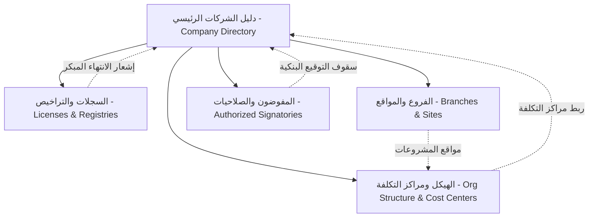

# منظومة ECO — منظومة تشغيل وإدارة الشركات (ERP Company Operations)
> **الكتالوج الشامل للمنتج والمعمارية التقنية للمنظومة**  
> *منظومة **ECO** (اختصار **ERP Company Operations** — باللغة العربية: **منظومة تشغيل وإدارة الشركات**) هي نظام سحابي متطور متعدد الشركات والمؤسسات (Multi-Tenant / Multi-Company) مبني على بيئة Cloudflare Edge السحابية وقاعدة بيانات Cloudflare D1 الموزعة.*

---

## 1. نظرة عامة على المنظومة (System Overview)

منظومة **ECO** (**ERP Company Operations — منظومة تشغيل وإدارة الشركات**) هي منصة أعمال مركزية متكاملة لإدارة كبرى المجموعات القابضة وشركات المقاولات والكيانات التجارية. تجمع المنظومة بين الإدارة المالية الدقيقة، الحوكمة المؤسسية الشاملة للشركات والكيانات التابعة، إدارة العقود والتراخيص والمشاريع، ومراقبة الصلاحيات والمفوضين البنكيين في بيئة رقمية آمنة وموحدة.

### 1.1 الركائز التكنولوجية الأساسية (Core Tech Stack)
- **الواجهة الأمامية (Frontend):** React 18, TypeScript, Tailwind CSS, Framer Motion, Lucide Icons.
- **التصميم والهوية البصرية:** نمط ألوان مزدوج فاخر ("الزيتوني الملكي والزمردي الداكن" في النمط الليلي + "الرمادي الصخري عالي التباين والأبيض النقي" في النمط النهاري).
- **الخلفية البرمجية السحابية (Backend Edge):** Cloudflare Pages Functions (`functions/api/...`) ذات الاستجابة فائقة السرعة على شبكة الحافة العالمية.
- **قواعد البيانات (Database):** Cloudflare D1 Distributed SQL Database (SQLite-compatible engine with zero server management).
- **نظام التخزين المزدوج (Hybrid State):** استجابة فورية من الذاكرة (Optimistic In-Memory Cache) مع مزامنة خلفية حية ومستمرة مع قاعدة بيانات D1 السحابية.

---

## 2. موديول إدارة الشركات والحوكمة المؤسسية (`Company Management`)

يُعد هذا الموديول عصب المنظومة المؤسسي الذي تنبثق منه كافة القيود والعمليات. يتكون من خمسة أقسام فرعية مترابطة بصورة تكاملية:



### 2.1 الأقسام الفرعية وإمكانياتها (Sub-Modules)

#### 🏢 1. دليل الشركات (Company Directory)
- **الهدف:** توثيق الكيانات القانونية التابعة للمجموعة ومتابعة هياكل الملكية ورؤوس الأموال.
- **القدرات:**
  - إدارة الاسم التجاري والقانوني (عربي/إنجليزي)، الكود الفريد، والكيان القانوني (مساهمة، ذ.م.م، فرع شركة أجنبية).
  - ضبط رأس المال المرخص به والمصدر والمدفوع بدقة، مع حساب تلقائي للقيمة الاسمية وعدد الأسهم.
  - جدول تفصيلي لهيكل المساهمين والشركاء مع احتساب وتدقيق النسب المئوية آلياً لضمان اكتمال 100%.
  - سجل تعديلات تفصيلي (Audit Trail) يوثق كل تغيير يطرأ على بيانات الشركة ومساهميها.
- **جدول D1 المرتبط:** `companies`
- **نقطة النهاية:** `/api/companies`

#### 📑 2. السجلات والتراخيص (Licenses & Registries)
- **الهدف:** الحوكمة القانونية والرقابة الصارمة على الوثائق والمستندات الرسمية ومواعيد تجديدها.
- **القدرات:**
  - تتبع السجل التجاري، البطاقة الضريبية، التسجيل بضريبة القيمة المضافة، شهادة تصنيف المقاولين، وتأمينات المنشأة.
  - محرك التنبيه الذكي لمواعيد الانتهاء:
    - 🔴 **منتهي الصلاحية:** تحذير فوري عاجل.
    - 🟡 **ينتهي قريباً (أقل من 45 يوماً):** إشعار مبكر لاتخاذ إجراءات التجديد.
    - 🟢 **ساري المفعول:** مستند نشط وموثق.
  - أرشفة إلكترونية للوثائق مع إمكانية رفع وتحميل ومعاينة مستندات PDF والصور مباشرة.
- **جدول D1 المرتبط:** `company_licenses`
- **نقطة النهاية:** `/api/licenses`

#### 📍 3. الفروع والمواقع والمستودعات (Branches & Sites)
- **الهدف:** إدارة التوزيع الجغرافي للمقرات الإدارية، المخازن المركزية، والورش، ومواقع العمل الإنشائية.
- **القدرات:**
  - تصنيف نوع الموقع (مقر رئيسي، فرع إقليمي، مستودع تشوين، موقع مشروع قيد التنفيذ، ورشة).
  - تحديد المدينة، العنوان التفصيلي، ورابط الموقع الجغرافي التفاعلي على Google Maps.
  - ربط الموقع بالمدير المسؤول، كادر العمل الوظيفي، وتاريخ التسليم المتوقع.
  - ربط كل موقع بمركز التكلفة المخصص له لضمان الرقابة التشغيلية.
- **جدول D1 المرتبط:** `branches_sites`
- **نقطة النهاية:** `/api/branches`

#### 🌳 4. الهيكل التنظيمي ومراكز التكلفة (Organizational Structure & Cost Centers)
- **الهدف:** رسم خارطة التبعية الإدارية والوحدات التشغيلية للمجموعة دون تداخل مالي.
- **القدرات:**
  - شجرة هرمية تفاعلية تعرض الإدارات العامة، الأقسام، والوحدات الفرعية التابعة.
  - ربط الإدارة بالشركة الأم والمقر/الفرع الجغرافي التابع له.
  - ربط رمزي مع أكواد مراكز التكلفة (`Cost Center Code`) لسهولة التنسيق مع المحاسبة.
  - حماية هرمية ذكية تمنع حذف أي إدارة رئيسية ما دامت تحتوي على أقسام أو وحدات تابعة لها.
- **جدول D1 المرتبط:** `departments`
- **نقطة النهاية:** `/api/departments`

#### ✍️ 5. المفوضون والصلاحيات البنكية والقانونية (Authorized Signatories)
- **الهدف:** حوكمة التوقيعات، الاعتمادات المالية، وحدود الصلاحيات أمام البنوك والجهات الرسمية.
- **القدرات:**
  - تحديد صفة المفوض (رئيس مجلس الإدارة، العضو المنتدب، المدير المالي، وكيل قانوني).
  - تحديد سقف التوقيع المنفرد وسقف التوقيع المشترك بالجنيه المصري.
  - مصفوفة صلاحيات تفصيلية تشمل: فتح الحسابات، إصدار الشيكات، التوكيل العام، خطابات الضمان، والتعامل مع الجهات الحكومية والضرائب.
  - التحقق من تواريخ انتهاء صلاحية التفويض وسريان التوكيلات الرسمية.
  - رفع وإرفاق أصل التوكيل أو القرار الإداري للمفوض مباشرة في المنظومة.
- **جدول D1 المرتبط:** `authorized_persons`
- **نقطة النهاية:** `/api/authorized-persons`

---

## 3. المعمارية السحابية وجداول قاعدة البيانات (Database Schema & API Specifications)

### 3.1 جداول Cloudflare D1
```sql
-- 1. الشركات
CREATE TABLE IF NOT EXISTS companies (
  id TEXT PRIMARY KEY,
  name_ar TEXT NOT NULL,
  name_en TEXT,
  legal_form TEXT NOT NULL,
  commercial_reg_no TEXT,
  tax_id TEXT,
  capital_authorized REAL,
  capital_issued REAL,
  shares_count INTEGER,
  share_nominal_value REAL,
  phone TEXT,
  email TEXT,
  address TEXT,
  shareholders_json TEXT,
  audit_logs_json TEXT,
  created_at TEXT DEFAULT CURRENT_TIMESTAMP,
  updated_at TEXT DEFAULT CURRENT_TIMESTAMP
);

-- 2. السجلات والتراخيص
CREATE TABLE IF NOT EXISTS company_licenses (
  id TEXT PRIMARY KEY,
  company_id TEXT NOT NULL,
  type_ar TEXT NOT NULL,
  license_number TEXT NOT NULL,
  issue_date TEXT NOT NULL,
  expiry_date TEXT NOT NULL,
  issuing_authority TEXT NOT NULL,
  file_url TEXT,
  notes TEXT,
  audit_logs_json TEXT,
  created_at TEXT DEFAULT CURRENT_TIMESTAMP
);

-- 3. الفروع والمواقع
CREATE TABLE IF NOT EXISTS branches_sites (
  id TEXT PRIMARY KEY,
  company_id TEXT NOT NULL,
  name_ar TEXT NOT NULL,
  type_ar TEXT NOT NULL,
  city_ar TEXT NOT NULL,
  address_ar TEXT NOT NULL,
  google_maps_url TEXT,
  manager_ar TEXT,
  phone TEXT,
  staff_count INTEGER DEFAULT 0,
  active_projects INTEGER DEFAULT 0,
  cost_center_code TEXT,
  start_date TEXT,
  expected_delivery_date TEXT,
  status TEXT DEFAULT 'نشط',
  notes_ar TEXT,
  audit_logs_json TEXT,
  created_at TEXT DEFAULT CURRENT_TIMESTAMP
);

-- 4. الهيكل التنظيمي
CREATE TABLE IF NOT EXISTS departments (
  id TEXT PRIMARY KEY,
  company_id TEXT NOT NULL,
  branch_id TEXT NOT NULL,
  parent_id TEXT,
  name_ar TEXT NOT NULL,
  code TEXT NOT NULL,
  head_ar TEXT,
  staff_count INTEGER DEFAULT 0,
  cost_center_code TEXT,
  sub_units_json TEXT,
  responsibilities TEXT,
  audit_logs_json TEXT,
  created_at TEXT DEFAULT CURRENT_TIMESTAMP
);

-- 5. المفوضون والصلاحيات
CREATE TABLE IF NOT EXISTS authorized_persons (
  id TEXT PRIMARY KEY,
  company_id TEXT NOT NULL,
  name_ar TEXT NOT NULL,
  title_ar TEXT NOT NULL,
  national_id TEXT NOT NULL,
  authority_type TEXT NOT NULL,
  single_limit REAL DEFAULT 0,
  joint_limit REAL DEFAULT 0,
  is_unlimited_duration INTEGER DEFAULT 0,
  expiry_date TEXT,
  power_of_attorney_no TEXT,
  can_open_accounts INTEGER DEFAULT 0,
  can_issue_checks INTEGER DEFAULT 0,
  can_sign_contracts INTEGER DEFAULT 0,
  can_issue_guarantees INTEGER DEFAULT 0,
  can_deal_government INTEGER DEFAULT 0,
  document_url TEXT,
  notes_ar TEXT,
  audit_logs_json TEXT,
  created_at TEXT DEFAULT CURRENT_TIMESTAMP
);

-- 6. التعريفات والقوائم المرنة
CREATE TABLE IF NOT EXISTS system_configurations (
  id TEXT PRIMARY KEY,
  category TEXT NOT NULL,
  code TEXT NOT NULL,
  label_ar TEXT NOT NULL,
  label_en TEXT,
  description_ar TEXT,
  sort_order INTEGER DEFAULT 0,
  is_active INTEGER DEFAULT 1,
  is_system INTEGER DEFAULT 0,
  created_at TEXT DEFAULT CURRENT_TIMESTAMP,
  updated_at TEXT DEFAULT CURRENT_TIMESTAMP,
  audit_logs_json TEXT
);
```

---

## 4. نظام المستخدمين ومصفوفة الصلاحيات الدقيقة (User Profiles & Granular RBAC)

### 4.1 القائمة التنفيذية لحساب المستخدم (`Executive User Menu`)
- **تطهير شامل للحسابات التجريبية:** تم إلغاء محول الحسابات الستة الوهمية وشارات المستويات المصطنعة (`L4` / `المستوى 4 - إدارة عليا`) بالكامل.
- **بطاقة الحساب الرسمية:** تعرض الاسم الكامل، المسمى الوظيفي الفعلي القابل للتخصيص والمحفوظ في D1 (مثل: `مدير النظام العام / رئيس مجلس الإدارة`)، البريد الرسمي، وحالة الاتصال.
- **نوافذ الإدارة التنفيذية الأربع:**
  1. **الملف الشخصي (`UserProfileModal`):** تعديل الاسم، المسمى الوظيفي، البريد، والهاتف وحفظها مباشرة في قاعدة البيانات.
  2. **الأمان وكلمة المرور (`ChangePasswordModal`):** تغيير كلمة المرور وتحديثها بأمان.
  3. **سجل حركات ونشاط المستخدم (`UserActivityDrawer`):** استعراض الإجراءات والعمليات السابقة مع فلاتر البحث والتصنيف.
  4. **إدارة المستخدمين ومصفوفة الصلاحيات (`PermissionsManagerModal`):** لوحة تحكم مصفوفية لمدير النظام لتحديد صلاحيات المستخدمين بدقة.
  5. **تسجيل الخروج:** زر إنهاء الجلسة الآمن.

### 4.2 مصفوفة الصلاحيات الدقيقة لإدارة الشركات (Company Suite RBAC Matrix)
تتضمن شجرة الصلاحيات **28 مفتاحاً تفصيلياً** تغطي كافة التبويبات والأزرار والإجراءات:

| الموديول الفرعي | مفاتيح الصلاحيات المتوفرة |
| :--- | :--- |
| **دليل الشركات** (`companies.directory`) | `view` (عرض), `create` (إضافة), `edit` (تعديل), `toggle_status` (تفعيل/إيقاف), `view_docs` (مستندات), `view_audit` (سجل التدقيق), `delete` (حذف) |
| **السجلات والتراخيص** (`companies.licenses`) | `view` (عرض), `create` (إضافة/رفع), `edit` (تعديل), `download` (معاينة/تحميل), `toggle_status` (سريان), `view_audit` (سجل التدقيق), `delete` (حذف) |
| **الفروع والمواقع** (`companies.branches`) | `view` (عرض), `create` (إضافة), `edit` (تعديل), `docs` (مستندات), `status` (حالة), `view_audit` (سجل التدقيق), `delete` (حذف) |
| **الهيكل ومراكز التكلفة** (`companies.org`) | `view` (عرض), `create` (إضافة إدارة/قسم), `edit` (تعديل), `docs` (لوائح), `status` (حالة), `view_audit` (سجل التدقيق), `delete` (حذف) |
| **المفوضون والصلاحيات** (`companies.signatories`) | `view` (عرض), `create` (إضافة مفوض), `edit` (تعديل), `download_poa` (تحميل التوكيل), `status` (حالة), `view_audit` (سجل التدقيق), `delete` (إلغاء/حذف) |

### 4.3 مصفوفة الصلاحيات التفاعلية لكافة قطاعات المنظومة الـ 12 (Enterprise 12-Module Interactive Matrix)
- **شاشة موحدة بتصميم 2-Column Matrix:**
  1. **العمود الأيمن:** قائمة قطاعات المنظومة الـ 12 تطابق السايدبار، مع شريط تقدم ونسبة الصلاحيات الممنوحة (`28 / 28`).
  2. **العمود الأيسر:** جدول تنفيذي مصفوفي يمثل كل قسم فرعي صفاً كاملاً، مع 7 أعمدة للمفاتيح القياسية: `عرض`، `إضافة`، `تعديل`، `مرفقات`، `حالة`، `تدقيق`، `حذف`، وزر `تحديد الكل` الخاص بالصف.
- **التخصيص المزدوج المرن:**
  - **حسب المستخدم (Per User):** اختيار أي مستخدم مسجل فعلياً من Cloudflare D1 (`managedUsers`) مع عرض اسمه ومسماه الوظيفي.
  - **حسب الدور الوظيفي (Per Role):** 6 أدوار قيادية بدون شارات L4/L3 مصطنعة.
- **تطهير كامل لواجهة المستخدم:** حذف الأكواد الخام (`Perm_...`) وشارات المستويات وحذف التكرار المزعج، مع توفير بانر علوي راقٍ لمدراء النظام.
- **المزامنة الحية المباشرة (Live Bi-Directional Wiring):**
  - حفظ فوري في Cloudflare D1 (`/api/permissions`) عبر `db.batch` و `UPSERT`.
  - بث حدث `eco-permissions-updated` لإنفاذ التغييرات لحظياً عبر السايدبار والتبويبات والأزرار بدون إعادة تحميل الصفحة.

### 4.4 محرك التعريفات والقوائم المرنة (Dynamic Configuration Engine)
- **الهدف:** القضاء التام على القوائم المنسدلة الجافة وتمكين مسؤولي النظام من إدارة وتحديث كافة التصنيفات والتعريفات بحرية سحابياً.
- **التصنيفات الخمسة الأساسية:**
  1. **الأدوار والمسميات الوظيفية (`roles`):** إدارة المسميات الوظيفية التنفيذية والإشرافية المتاحة في بطاقات ونماذج المستخدمين.
  2. **الأقسام والإدارات والتخصصات (`departments`):** توثيق الهياكل الإدارية وتوزيع كوادر العمل.
  3. **أنواع الوثائق والتراخيص (`doc_types`):** تصنيف التراخيص والشهادات وسجلات التأمينات والاتحادات.
  4. **أنواع المقرات والمواقع (`branch_types`):** تصنيف المواقع (مقر رئيسي، فرع إقليمي، مستودع تشوين، موقع مشروع قيد التنفيذ، ورشة).
  5. **صفات التفويض والتوكيلات (`signatory_titles`):** صفات المفوضين القانونيين والبنكيين (رئيس مجلس الإدارة، العضو المنتدب، المدير المالي، وكيل قانوني).
- **القدرات التشغيلية:**
  - واجهة تحكم متكاملة تدعم عمليات الإضافة والتعديل والتعطيل والحذف مع سجل تدقيق تفصيلي لكل بند.
  - حفظ دائم في جدول `system_configurations` عبر نقطة النهاية السحابية `/api/configurations`.

### 4.5 مكون القائمة الذكية القابلة للإضافة الفورية (`<CreatableSelect />`)
- **الهدف:** تجربة مستخدم سلسة وفورية أثناء إدخال البيانات دون انقطاع سير العمل.
- **القدرات:**
  - بحث تفاعلي وفلترة سريعة للخيارات المتاحة.
  - عند كتابة قيمة جديدة غير موجودة بالقائمة، يظهر زر تفاعلي بارز: `+ إضافة "[النص]" وحفظه في التعريفات فوراً`.
  - يتم استدعاء API التعريفات، وتحديث جدول D1، وإدراج الخيار الجديد في القائمة النشطة واختياره مباشرة في الحقل دون إغلاق النموذج المنبثق الحالي أو إعادة تعيينه.

### 4.6 تطهير وتحديث إدارة المستخدمين (`User Management Overhaul`)
- **نقاء البيانات:** إزالة كافة الأسماء الوهمية (`م. إبراهيم خليل`)، البريد المستعار (`khalil@hrsup.com`)، والأرقام القومية المصطنعة، واستبدالها بنصوص إرشادية عربية احترافية.
- **إلغاء المستويات القديمة:** استبعاد شارات وقوائم `Level 1 - 4` بالكامل، وربط المستخدمين مباشرة بمصفوفة RBAC الحقيقية.
- **شريط الإجراءات الأيقوني الذهبي:**
  - 🛡️ **تخصيص الصلاحيات:** يفتح مصفوفة الصلاحيات فوراً للمستخدم المحدد.
  - ℹ️ **سجل التدقيق التفصيلي:** استعراض تاريخ تعديلات الحساب بالفروق الدقيقة (من -> إلى).
  - ⚡ **تفعيل/تعطيل الحساب:** مفتاح تشغيل سريع للحالة النشطة أو المعلقة.
  - ✏️ **تعديل بيانات المستخدم:** نافذة تحرير متكاملة تدعم الحقول الموسعة.
  - 🗑️ **حذف المستخدم:** مع حماية مطلقة لحساب الإدارة العليا الرئيسي (`admin`).

### 4.7 معيار مؤشر الفأرة الداكن والتباين البصري (Guaranteed Dark SVG Cursor)
- اعتماد مؤشر SVG Data-URI دقيق وعالي التباين في `src/index.css` للنمط الفاتح، مما يمنع نهائياً مشكلة انعكاس المؤشر إلى الأبيض الناجمة عن معالجات Chromium في بيئات Windows.
- فرض خلفيات بيضاء صلبة `#ffffff` ولون نص داكن `#0f172a` ولون مؤشر كهرماني دافئ `caret-color: #d97706`.
- إخفاء أسهم الأرقام الافتراضية (Number Spinners) عبر CSS عالمي.
- مزامنة مسار المتصفح (URL Route Sync) تلقائياً عند التنقل بين موديولات الإعدادات وتطهير معلمات الاستعلام.

### 4.8 إنفاذ الهوية الكهرمانية المؤسسية والمعاينة الحية للوثائق والـ PDF (Brand Amber & Live Blob Preview)
- **تطهير الألوان الزمردية الدخيلة:** استبعاد درجات الأخضر والزمرد الفاقع من أزرار التحميل والمعاينة وشارات الملفات، واستبدالها بتدرج الكهرمان والذهب المؤسسي الفاخر:
  `bg-gradient-to-l from-amber-600 to-amber-500 hover:from-amber-700 hover:to-amber-600 text-white shadow-md shadow-amber-500/20 font-bold`.
- **معاينة الـ PDF المدمجة عبر كائنات Blob:** تحويل ملفات الـ PDF المشفرة تلقائياً إلى كائنات ثنائية `Blob URL` وعرضها داخل إطار تفاعلي عريض:
  `<iframe src={`${blobUrl}#toolbar=1&navpanes=0&view=FitH`} className="w-full h-[68vh] ... shadow-inner" />`
  مع توسيع نافذة المعاينة الموحدة إلى `max-w-4xl w-full` وتوفير أدوات التكبير والتصغير للصور والتنزيل المباشر.

### 4.9 محرك الحماية والتحديث القسري وتطهير الكاش التلقائي عند كل إصدار (Automated Force-Logout Engine)
- **معرف البناء الفريد (`BUILD_ID`):** ختم كل بناء برقم فريد في `vite.config.ts` وكتابة ملف `version.json` تلقائياً مع ترويسة تمنع التخزين المؤقت نهائياً (`no-store, no-cache, must-revalidate`).
- **مراقب نبضات النسخة:** فحص دوري كل 25 ثانية وعند استعادة التركيز للنافذة.
- **التطهير الشامل للجلسات والكاش:** فور اكتشاف إصدار أحدث أو تعديل في الصلاحيات (`security_epoch`)، يتم تسجيل خروج المستخدمين فوراً، ومسح كافة مخازن الكاش `caches.keys()`، وإلغاء تسجيل الـ Service Workers، وإعادة التوجيه إلى `/login?reason=system_updated` مع إشعار كهرماني أنيق.

### 4.10 شاشة الترحيب السينمائية ثلاثية الأبعاد بعد تسجيل الدخول (Permanent 3D Cinematic Welcome Splash)
- **المعمارية الجذرية الثابتة (Root-Level Execution):** استدعاء `<CinematicWelcomeSplash />` في جذر التطبيق `App.tsx` عند نجاح المصادقة، مما يمنع انفكاكها المفاجئ في 0ms ويوفر تجربة ترحيب ملكية فاخرة.
- **محرك الفضاء والمدارات ثلاثية الأبعاد (Canvas 3D Depth & Gyro Rings):** محاكاة فضاء عميقة مع حركة شهب ثلاثية الأبعاد نحو الكاميرا على المحور Z، وأرضية معمارية هولوغرافية مائلة، و 3 حلقات مدارية جيروسكوبية تدور حول درع المنظومة الذهبي الخالص.
- **إبراز هوية المستخدم والتخصص المؤسسي:** عرض الاسم الكامل للمستخدم (`user.nameAr`) بتيبوغرافيا ذهبية، مع كبسولة زجاجية تبرز المسمى الوظيفي والتخصص الدقيق (`user.jobTitleAr` / `user.roleLabelAr`) والقسم المؤسسي وسياق الشركة النشطة.
- **شريط التقدم التلقائي وزر التخطي:** شريط تقدم ذهبي يكتمل خلال 3.6 ثانية مع تبديل نصوص الحالة السحابية، يليه انتقال انسيابي (`AnimatePresence`) إلى شاشات المنظومة مع إمكانية التخطي الفوري.

### 4.11 محرك الموارد البشرية السحابي الشامل وتطهير البيانات الوهمية (HRMS D1 Engine & Clean Architecture)
- **المخطط العلائقي الشامل في Cloudflare D1:** تأسيس 7 جداول سحابية مترابطة بفهارس تسريع (`hr_employees`, `hr_contracts`, `hr_attendance`, `hr_leaves`, `hr_loans`, `hr_rewards_penalties`, `hr_payroll_runs`) مع نقطة نهاية موحدة `/api/hr` تدعم عمليات CRUD والـ UPSERT الذكي عبر الحافة السحابية.
- **التطهير الكامل للبيانات الوهمية (Zero Mock Data):** تصفير كافة الموظفين المصطنعين والعدادات الثابتة، وتقديم حالة فارغة تنفيذية فخمة (Executive Empty State) عندما يكون عدد الكوادر 0 لتحفيز تسجيل الموظف الأول بوضوح.
- **التنظيف الهيكلي الصارم وإلغاء الازدواجية:** إزالة شريط التبويبات الأفقي العلوي المكرر داخل `HRModule.tsx` لتكريس التنقل الحصري عبر القائمة الجانبية وتوفير 100% من مساحة العمل، وحذف تبويب وملف `PayrollExView.tsx` بالكامل، ودمج نواقص الملفات في واجهة تدقيق موحدة `MissingDocumentsAuditView.tsx` (`مسوغات التعيين ونواقص الملفات`).
- **الربط الحي بالشركات والفروع:** ربط كبسولات التصفية وفلاتر الإدارات بقواعد بيانات `companies` و `branches` الحية عبر `companyStorage` و `branchStorage`.
- **مستودع التزامن التفاؤلي الذكي (`hrStorage.ts`):** استجابة فورية فائقة السرعة للواجهات عبر التخزين المحلي المؤقت وتحديث البيانات خلفياً مع بث حدث عام `eco-hr-updated`.
- **معايير التصميم الفاخر وتجربة الاستخدام:** تطبيق تدرجات الكهرمان والذهب المؤسسية (Brand Amber) على كافة الأزرار والتبويبات النشطة، حظر الأصفار المسبقة في حقول الأجور وإخفاء أسهم الأرقام الافتراضية، واعتماد القوائم الذكية المفتوحة `<CreatableSelect />` والمعاينة الحية للوثائق بنظام `Blob URL` المدمج عبر `<DocumentPreviewModal />`.

### 4.12 الترقية السينمائية ثلاثية الأبعاد، بطاقات الشركات وبحث الهيدر الفائق (3D Cinematic Hero & Header Suite)
- **شعار المنظومة الرسمي والتيبوغرافيا الحركية المركزة:** اعتماد الشعار الرسمي للمبنى المؤسسي في حاوية ثلاثية الأبعاد بظلال ذهبية طافية، وتوسيط اسم المنظومة **`ECO`** مع عبارة **`ERP Company Operations`** كاملة عبر تأثير الآلة الكاتبة الحركي (`TypewriterText`) دون أي بتر للحروف، مع إزالة شارة `ENTERPRISE` والنقطة الجانبية.
- **البنر السينمائي ثلاثي الأبعاد وبطاقات الشركات الحية:** دمج كانفاس تفاعلي ثلاثي الأبعاد داخل بنر الترحيب مزود بشبكة منظوريه متحركة، وحلقات مدارية ثلاثية الأبعاد، وجزيئات ذهبية متكيفة مع النمطين، واستبدال النص التجريدي `جميع الشركات (1)` ببطاقات حقيقية تفاعلية لكل شركة مصرح بها مع إبراز اسمها وسجلها التجاري وأيقونتها المؤسسية.
- **شريط البحث الفائق الذكي (Supercharged Search Bar):** إطار ذهبي كهرماني دوار متوهج، نص إرشادي متحرك (Typewriter Placeholder) يتنقل بين 3 عبارات بحثية، وزر اختصار ثلاثي الأبعاد `⌘ K` وقائمة منسدلة فورية للوصول للأقسام والشركات بنقرة واحدة.
- **إغلاق القائمة الجانبية افتراضياً وتطهير الكلمات الإنجليزية:** إغلاق كافة موديولات القائمة الجانبية الـ 12 عند بدء التشغيل (`expandedCategories = []`)، وحذف عبارة `(Mini-Rail)` ليصبح زر الطي صريحاً وأنيقاً: `تصغير القائمة`.

### 4.13 موديول الاستقبال والزوار والمعمارية السحابية الخماسية المترابطة (Cloudflare D1 Reception Suite & 3D Amber Engine)
- **البنية السحابية الخماسية على Cloudflare D1:** تأسيس 5 جداول متكاملة على الحافة السحابية (`rec_visitors`, `rec_room_bookings`, `rec_parcels`, `rec_calls`, `rec_contractor_permits`) مع نقطة نهاية موحدة `/api/reception` ونظام تحقق تلقائي لمنع التعارض الزمني في حجز القاعات ومسار استعلام سريع للإحصائيات `/api/reception/stats`.
- **التطهير الشامل للبيانات الوهمية والعدادات الحقيقية:** إزالة كافة الزوار والحجوزات والمكالمات والطرود والتصاريح الوهمية بنسبة 100%، وعرض عدادات حقيقية تبدأ من `0`، مع حالة فارغة سينمائية فاخرة (Executive Animated Empty State) تشجع على بدء النشاط بزر كهرماني مباشر.
- **التكامل الحي الشامل:** ربط النماذج بالشركات المسجلة (`companyStorage`) وفروعها ومواقعها (`branchStorage`) والموظفين المضيفين والمستلمين من (`hr_employees`) مع القوائم الذكية المفتوحة `<CreatableSelect />` للقاعات وشركات الشحن.
- **البنر السينمائي ثلاثي الأبعاد وهوية الكهرمان الملكية:** كانفاس تفاعلي علوي يعكس حالة المرفق بشبكة منظوريه متحركة ثلاثية الأبعاد وجزيئات ذهبية وعدادات KPI حية.
- **بطاقة التصريح الرقمية التفاعلية ثلاثية الأبعاد (Interactive 3D Digital Access Pass):** نافذة تصريح دخول زجاجية هولوغرافية بـ SVG QR Code حقيقي يحمل تفاصيل الزيارة والتصريح مع زر طباعة رسمي فوري (`@media print`).
- **المعاينة الحية للوثائق (`Blob URL`) والشريط الأيقوني ودرج التدقيق (`! Audit Log`):** عارض PDF وصور ضوئية مدمج عبر كائنات ثنائية حية، وشريط إجراءات موحد بالأيقونات، ودرج لمراجعة سجل التغييرات الدقيق.

### 4.14 إدارة المستخدمين والهوية المؤسسية السحابية (User Identity & Multi-Company IAM Suite)
- **درع حظر الملء التلقائي للمتصفح (Anti-Autofill Shield):** تهيئة حقول إضافة المستخدمين بقيم فارغة `""`، واستخدام سمات `autoComplete="new-password"` وأسماء فريدة مع نمط قفل القراءة حتى التركيز لمنع Chromium من حقن بيانات المدير الجذري `admin@hrsup.com` المحفوظة.
- **بطاقات الهوية التنفيذية ثلاثية الأبعاد (3D ID Badge Cards):** تصميم كل مستخدم كبطاقة هوية زجاجية فاخرة بهالة أفاتار متوهجة ونقطة نبض حالة الاتصال النشطة، وشارات التسكين الوظيفي، وبطاقات نطاق الشركات المصرح بها (`جميع الشركات` أو شركات مختارة)، وشريط إجراءات أيقوني ذهبي لمصفوفة الصلاحيات (RBAC)، وإعادة تعيين كلمة المرور السريعة 🔑، وسجل التعديلات التدقيقي ℹ️، وتبديل الحالة ⚡، والتعديل ✏️، والحذف 🗑️.
- **تحديد نطاق الشركات المصرح بها ومقياس قوة كلمة المرور:** تمكين مسؤولي النظام من تقييد وصول المستخدم لشركات معينة مسجلة في المنظومة أو منحه وصولاً شاملاً لكافة الكيانات، مع محرك حي لقياس قوة كلمة المرور وزر توليد كلمات المرور المعقدة `⚡ توليد تلقائي`، ودعم الاستيراد السريع بنقرة واحدة من كادر الموظفين (`hr_employees`).
- **تطهير القوائم المنسدلة `<CreatableSelect />` ومزامنة الهيكل التنظيمي:** قصر العرض على المسميات العربية المهنية الصافية دون أي أكواد إنجليزية أو شروحات إعلانية، ومزامنة الأقسام ديناميكياً مع الأقسام الفعلية بالهيكل التنظيمي (`departmentStorage.getDepartments()`).
- **الأكورديون الفردي الحصري للقائمة الجانبية (Single-Accordion):** ضبط القائمة الجانبية لتتمدد بنظام الأكورديون الفردي الصارم، بحيث يؤدي فتح أي قسم أو موديول إلى طي الموديولات المفتوحة سابقاً تلقائياً لمنع التشتت وتكدس القوائم.

### 4.15 محرك التعريفات والقوائم المرنة المعتمدة (Dynamic Configuration Engine Suite)
- **ثبات حالة Cloudflare D1 بدون إعادة بذر (True D1 State Persistence):** منع إعادة حقن السجلات الافتراضية عند طلبات `GET /api/configurations` عبر راية تهيئة أحادية لمرة واحدة في `system_init_flags`. التعديل والحذف دائم ولا يُعاد إحياء أي سجل محذوف عند تحديث الصفحة (F5).
- **عمليات CRUD حقيقية ومطلقة وتصفير القوائم (Unrestricted CRUD & Category Wipe):** إمكانية تعديل وحذف كافة المسميات دون أي قفل برمجي وهمي (`is_system`)، مع زر تصفير القائمة بالكامل (`clearCategory`) لتنظيف أي تصنيف بنقرة واحدة.
- **تتبع الفروق الدقيقة في سجل التعديلات (Field-Diff Audit Engine):** رصد وتخزين مقارنة القيم السابقة والجديدة (قبل -> بعد) في `audit_log_json` وعرضها بنافذة تدقيق تفاعلية للمستخدم.
- **تطهير الشوائب ومصطلحات المطورين ومنتقي ألوان قوس قزح:** حذف شارات `مزامنة D1 حية` و `SYSTEM` و `SUPER_ADMIN`، وإلغاء دوائر ألوان قوس قزح الثمانية العشوائية، واعتماد بالتة الكهرمان والزيتوني الملكي الرسمية لكافة البطاقات والأيقونات.
- **البنر السينمائي ثلاثي الأبعاد والنموذج العملي الرباعي:** بنر تفاعلي بـ 4 عدادات حية من D1 (`إجمالي التعريفات`, `المسميات الوظيفية`, `الأقسام والتخصصات`, `أنواع الوثائق والمقرات`) ونموذج إضافة وتعديل يقتصر على 4 حقول عملية (المسمى بالعربية، المسمى بالإنجليزية، التصنيف، والحالة).
- **المزامنة اللحظية الشاملة (`eco-configurations-updated`):** ربط فوري يحدث كافة حقول `<CreatableSelect />` عبر كافة موديولات الـ ERP فور أي إضافة أو تعديل أو حذف.

### 4.16 سجل العمليات والرقابة الأمنية (Audit Log & Security Oversight Suite)
- **توحيد بالتة الكهرمان وحظر الأسود المصمت:** زر الفلتر النشط يعتمد التدرج الكهرماني الذهبي الفاخر `from-amber-600 to-amber-500` مع أزرار غير نشطة عاجية وزيتونية، واستبعاد الشارات البنفسجية والزرقاء الشاذة.
- **البنر السينمائي ثلاثي الأبعاد وإحصائيات الرقابة الحية:** بنر علوي بهالة منظوريه دائرية يعرض مؤشرات لحظية (`إجمالي السجلات المسجلة`, `حركات اليوم النشطة`, `حالة الأمان والنزاهة السحابية`) مع زر تحديث سحابي مباشر من `d1Client.fetchAuditLogs()`.
- **بطاقات السجلات الزجاجية ثلاثية الأبعاد (3D Glassmorphic Log Cards):** تصميم كل سجل كبطاقة زجاجية 3D بارتفاع حركي خفيف عند التحويم (`hover:-translate-y-0.5`).
- **نافذة فحص تفاصيل السجل (Log Inspection Modal):** نافذة منبثقة زجاجية متكاملة تتيح معاينة تفاصيل السجل، هوية المنفذ بهالة كهرمانية، عنوان الـ IP، والطابع الزمني، وشهادة الأمان السحابية في Cloudflare D1.

### 4.17 لوحة التحكم في ترقيات الحافة السحابية (Cloudflare Edge Deployment Controller Suite)
- **توحيد أزرار الإجراءات ببالتة الكهرمان والزيتوني الملكي:** اعتماد التدرج الكهرماني الذهبي الفاخر `from-amber-600 to-amber-500` لأزرار الإجراءات الأساسية والبث الفوري، والنمط الزجاجي الكهرماني الزيتوني لزر إنهاء التحديث، وحظر الألوان المتنافرة.
- **البنر السينمائي ثلاثي الأبعاد لشبكة الحافة:** هيدر علوي بعمق منظورِي وهالات دائرية متحركة يعرض حالة شبكة Cloudflare Workers والعقد المتصلة.
- **بطاقات الإصدارات الزجاجية ثلاثية الأبعاد:** تحويل بطاقات الإصدارات (`المتصفح الحالي`, `سيرفر D1`, `حالة التحديث`) إلى كروت زجاجية 3D بارتفاع حركي ناعم عند التحويم.
- **حلقات التركيز الكهرمانية للمدخلات:** تطبيق إطارات تركيز ناعمة `focus:ring-2 focus:ring-amber-500/30 focus:border-amber-500` على حقول النصوص والرسائل الإرشادية.

### 4.18 منظومة إنفاذ الصلاحيات الحية وعزل الشركات المتعددة (Dynamic RBAC & Multi-Company Security Suite)
- **استرجاع وحفظ نطاق الصلاحيات والشركات الحقيقي:** ربط نقاط نهاية المصادقة في Cloudflare D1 (`login.ts` و `me.ts`) لتمرير `permissions_json` و `allowed_company_ids` وحفظها في جلسة التخزين.
- **عزل الشركات المتعددة على مستوى الـ Context:** ربط `TenantContext` ببيانات المستخدم ليتم حصر الشركات المتاحة في الهيدر والبانر وكافة موديولات المنظومة بالشركات المصرح بها فقط.
### 4.19 محرك التعريفات المرنة، تطهير العناوين، وشبكة الأحداث الحية (Configuration Engine, Clean Titles & Zero-Refresh Architecture)
- **ثبات واستدامة الحفظ في Cloudflare D1:** منع إعادة زرع البذور الافتراضية تلقائياً في طلبات `GET /api/configurations` واحترام حذف وتعديل المستخدم لجميع العناصر والقوائم نهائياً.
- **تطهير المسميات والعناوين العربية (`cleanArabicTitle`):** إزالة الشرطات السفلية والوسوم التقنية المصطنعة (`(C-Suite)`, `(CFO)`, `(HRD)`, `(HRMS)`, إلخ) وضمان ظهور أسماء عربية فخمة نقية.
- **تحديث حي فوري بدون ريفريش (Zero-Refresh Live Mesh):** ربط عمليات التعديل والإضافة بحدث `eco-data-updated` الموحد وتحديث مكونات `<CreatableSelect />` ولوحة القيادة `<EmptyCanvas />` ومحرك الإعدادات فورياً دون الحاجة لإعادة تحميل المتصفح.
- **تأمين القائمة العلوية للهيدر:** حجب خيار `إدارة المستخدمين ومصفوفة الصلاحيات` عن أي مستخدم لا يملك صلاحية حوكمة إدارية صريحة.
- **ترقية بطاقات الموديولات الـ 12:** تطبيق هوية الكهرمان والزيتوني الملكي مع منع اقتطاع الشروح التوضيحية عبر `line-clamp-2`.

### 4.20 مصفوفة الصلاحيات الشاملة لكافة الـ 12 موديول والربط الحبيبي (Enterprise 12-Module RBAC Modal & Action Matrix)
- **نافذة مصفوفة الصلاحيات التفاعلية (`PermissionsManagerModal`):**
  - استيعاب كامل موديولات المنظومة الـ 12 في شريط تنقل يمين متناسق مع أيقونات وعدادات فورية لمؤشرات الأذونات (`active / total`).
  - جدول مصفوفة حبيبي للتبويبات الفرعية بأعمدة الأذونات الستة القياسية: `عرض` (👁️)، `إضافة` (➕)، `تعديل` (✏️)، `مرفقات/حالة` (📎)، `السجل (!)` (ℹ️)، و `حذف` (🗑️).
  - تحديد سريع على مستوى الصف بالكامل، القسم بالكامل، أو المنظومة بأسرها بنقرة واحدة، مع حفظ فوري في Cloudflare D1 وبث الأحداث الحية.
- **تكامل محرك الصلاحيات والتحقق الحبيبي (`AuthContext.tsx`):**
  - دعم بادئات مفاتيح الصلاحيات المختصرة عبر `prefixMap` وخريطة `SUBMODULE_VIEW_PERMISSION_MAP` لضمان إتاحة التبويبات المسموحة بدقة وحجب التبويبات المحظورة.
  - تصفية اللوحة الرئيسية (`EmptyCanvas.tsx`) وإخفاء أي موديول لا يملك المستخدم صلاحية عرض لأي من عناصره، وعرض عدد الخدمات المصرح بها فقط.

---

## 5. نظام الحوكمة والذاكرة الذكية الأربعة (4-File Governance System)

تخضع كافة أعمال التطوير والتحديث لبروتوكول صارم يعتمد على 4 ملفات أساسية في جذر المشروع:

| الملف | دوره ووظيفته |
| :--- | :--- |
| **`MISTAKES.md`** | سجل الأخطاء والدروس المستفادة لمنع تكرار أي خلل في التصميم، الذاكرة، الصلاحيات، أو النوافذ. |
| **`SKILLS.md`** | دليل الأنماط البرمجية المعتمدة (D1 Edge, Audit Trail, Dual-Theme, Granular RBAC, Executive Profile). |
| **`PROMPTS.md`** | دستور المعايير الذهبية الموحدة (Golden Standards Checklist) للموديولات وقوائم الصلاحيات. |
| **`README.md`** | الكتالوج الحي والمعماري الشامل للمنظومة ومصفوفة الصلاحيات بالكامل. |

---

## 6. ضوابط التشغيل والبناء (Build & Run Commands)

- **فحص الأنواع وتكامل TypeScript:**
  ```bash
  npx tsc --noEmit
  ```
- **بناء حزمة الإنتاج للمشروع:**
  ```bash
  npm run build
  ```
- **تشغيل بيئة التطوير المحلية:**
  ```bash
  npm run dev
  ```
